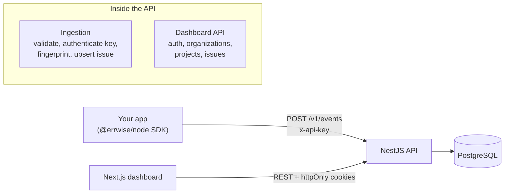

<div align="center">

# Errwise

**Error monitoring for developers. Install the SDK, see every crash in one dashboard.**

[](https://github.com/AzizHamdi99/errwise/actions/workflows/ci.yml)


[Live demo](#) · [Documentation](docs/) · [Roadmap](docs/ROADMAP.md)

</div>

---

## Why Errwise

When an app crashes in production, you usually find out from a user. Errwise collects every unhandled error from your application, groups identical ones into **issues**, and shows them in one dashboard with the stack trace, environment, release and context you need to fix them.

> "Collect all my application errors in one dashboard."

It is a from-scratch, multi-tenant take on tools like Sentry, built to be small, readable and fully deployable on free tiers.

## Project status

Errwise is under active development. The platform (accounts, organizations, projects, API keys) is done. The ingestion pipeline, the SDK and the dashboard are next.

| Area                                       | Status  |
| ------------------------------------------ | ------- |
| Authentication (access and refresh tokens) | Done    |
| Organizations and roles                    | Done    |
| Invitations by email                       | Done    |
| Projects                                   | Done    |
| API keys (hashed, revocable)               | Done    |
| Event ingestion (`POST /v1/events`)        | Planned |
| Fingerprinting and issues                  | Planned |
| Node SDK (`@errwise/node`)                 | Planned |
| Dashboard (Next.js)                        | Planned |
| Deployment and live demo                   | Planned |

## How it will work

```ts
// 1. Install: yarn add @errwise/node
import { Errwise } from "@errwise/node";

// 2. Initialize once, with the key from your project
Errwise.init({
  apiKey: "ew_live_...",
  environment: "production",
  release: "1.0.0",
});

// 3. Crash your app. The error shows up in the dashboard,
//    grouped with identical ones and counted.
```

> The SDK is not published yet. This is the target developer experience.

## Features

### Available now

- **Authentication**: register and login with bcrypt-hashed passwords, short-lived JWT access tokens, and rotating refresh tokens stored as hashes. Reusing an old refresh token revokes the whole session family. Tokens travel in `httpOnly` cookies.
- **Multi-tenancy**: users belong to organizations through memberships with three roles (`owner`, `admin`, `member`). A guard checks the role on every route, and non-members get a `404`, so organization ids never leak.
- **Invitations**: owners and admins invite teammates by email. The link carries a single-use token that is stored hashed and expires. Only the invited address can accept, and accepting verifies that email.
- **Projects**: each organization has projects with a platform and a retention period. Only owners can create, edit or delete them.
- **API keys**: `ew_live_` plus 32 random characters, shown once, stored only as a SHA-256 hash, revocable, with `lastUsedAt` tracking. A key resolves its project through a database lookup, never from the request body.
- **Mail drivers**: a console driver for development and tests, and an SMTP driver for real emails.
- **Validation at the edge**: every request body is validated with Zod schemas shared across the whole monorepo.

### Coming next

- Event ingestion with idempotency (`eventId`), size limits and per-key rate limiting
- Fingerprinting: identical errors are grouped into one issue with a counter
- A zero-dependency Node SDK with Express and NestJS integrations, batching, retries, and a safe flush on crash
- A dashboard with issue list, filters, search, stack traces, resolve and ignore
- A retention job that deletes old events to fit free-tier storage

## Architecture



The API follows a layered structure in every module:

```
Controller  ->  Service  ->  Repository  ->  Prisma
(HTTP, Zod)    (rules)      (queries)
```

Only repositories talk to the database. Services never import Prisma, and controllers never hold business rules.

### Data model

```
User ──< Membership >── Organization ──< Project ──< ApiKey
                  │                          │
                  └── Invitation             ├──< Issue ──< Event
                                             └──────────────< Event
```

- An `Issue` is unique per `(projectId, fingerprint)` and holds the counters.
- An `Event` is unique per `(projectId, eventId)`, which makes ingestion idempotent.
- Organizations and projects are soft-deleted.

## Tech stack

| Layer      | Choice                                             |
| ---------- | -------------------------------------------------- |
| Monorepo   | Yarn 4 workspaces, Turborepo                       |
| API        | NestJS, TypeScript                                 |
| Database   | PostgreSQL 16, Prisma 6                            |
| Validation | Zod (shared between API, web and SDK)              |
| Auth       | JWT access tokens, rotating refresh tokens, bcrypt |
| Dashboard  | Next.js, Tailwind CSS, shadcn/ui, TanStack Query   |
| Email      | Nodemailer (SMTP), console driver for development  |
| CI         | GitHub Actions                                     |

## Repository structure

```
errwise/
├─ apps/
│  ├─ api/            NestJS API (modules: auth, users, organizations,
│  │                  memberships, invitations, projects, api-keys, mail)
│  ├─ web/            Next.js dashboard
│  └─ demo-app/       App that throws errors on demand (planned)
├─ packages/
│  ├─ shared/         Zod schemas and types shared by api, web and sdk
│  └─ sdk/            @errwise/node (planned)
├─ docs/              Architecture notes, ADRs, roadmap
├─ docker-compose.yml Local PostgreSQL
└─ turbo.json
```

Rules: apps never import from other apps, only from `packages/*`. The SDK will have no runtime dependencies. Only the API touches the database.

## Getting started

### Prerequisites

- Node.js 24 and Corepack (`corepack enable`)
- Docker (for the local database)

### Setup

```bash
# 1. Install dependencies
yarn install

# 2. Start PostgreSQL
yarn db:up

# 3. Configure the API
cp apps/api/.env.example apps/api/.env
# then set JWT_SECRET to a long random value

# 4. Build the shared package and apply the migrations
yarn workspace @errwise/shared build
yarn db:migrate

# 5. Run the API
yarn dev:api
```

The API listens on `http://localhost:4000`.

While you work on the shared package, keep it rebuilding in a second terminal:

```bash
yarn workspace @errwise/shared dev
```

### Environment variables

| Variable                                        | Description                               | Default                 |
| ----------------------------------------------- | ----------------------------------------- | ----------------------- |
| `DATABASE_URL`                                  | PostgreSQL connection string              | required                |
| `DIRECT_URL`                                    | Direct connection used for migrations     | required                |
| `JWT_SECRET`                                    | Secret for access tokens (16+ characters) | required                |
| `API_PORT`                                      | API port                                  | `4000`                  |
| `WEB_URL`                                       | Dashboard URL (CORS and email links)      | `http://localhost:3000` |
| `ACCESS_TOKEN_TTL_SECONDS`                      | Access token lifetime                     | `900`                   |
| `REFRESH_TOKEN_TTL_DAYS`                        | Refresh token lifetime                    | `30`                    |
| `BCRYPT_ROUNDS`                                 | bcrypt cost                               | `12`                    |
| `INVITATION_TTL_DAYS`                           | Invitation lifetime                       | `7`                     |
| `MAIL_DRIVER`                                   | `console` (prints emails) or `smtp`       | `console`               |
| `MAIL_FROM`                                     | Sender address                            |                         |
| `SMTP_HOST` `SMTP_PORT` `SMTP_USER` `SMTP_PASS` | Required when `MAIL_DRIVER=smtp`          |                         |

All variables are validated with Zod at startup, and the API refuses to start if one is invalid.

With `MAIL_DRIVER=console`, invitation emails (and their links) are printed in the API terminal, so you don't need a mail server in development.

### Useful scripts

| Command                       | What it does                                    |
| ----------------------------- | ----------------------------------------------- |
| `yarn dev:api`                | Run the API in watch mode                       |
| `yarn dev:web`                | Run the dashboard                               |
| `yarn db:up` / `yarn db:down` | Start or stop local PostgreSQL                  |
| `yarn db:migrate`             | Create and apply a migration (development only) |
| `yarn db:studio`              | Open Prisma Studio                              |
| `yarn build`                  | Build every workspace                           |
| `yarn lint`                   | Lint every workspace                            |

## API overview

Everything under `/organizations/:orgId` requires login and membership of that organization.

| Method              | Path                                                   | Who                        |
| ------------------- | ------------------------------------------------------ | -------------------------- |
| POST                | `/auth/register`, `/auth/login`                        | Public                     |
| POST                | `/auth/refresh`, `/auth/logout`                        | Refresh cookie             |
| GET                 | `/me`                                                  | Logged-in user             |
| POST, GET           | `/organizations`                                       | Logged-in user             |
| GET                 | `/organizations/:orgId`                                | Any member                 |
| PATCH               | `/organizations/:orgId`                                | Owner, admin               |
| DELETE              | `/organizations/:orgId`                                | Owner                      |
| GET, PATCH, DELETE  | `/organizations/:orgId/members[/:userId]`              | Member / owner / see rules |
| POST, GET, DELETE   | `/organizations/:orgId/invitations[/:id]`              | Owner, admin               |
| POST                | `/organizations/:orgId/invitations/:id/resend`         | Owner, admin               |
| POST                | `/invitations/preview`, `/invitations/accept`          | Token holder               |
| GET                 | `/organizations/:orgId/projects[/:id]`                 | Any member                 |
| POST, PATCH, DELETE | `/organizations/:orgId/projects[/:id]`                 | Owner                      |
| GET                 | `/organizations/:orgId/projects/:id/api-keys`          | Any member                 |
| POST, DELETE        | `/organizations/:orgId/projects/:id/api-keys[/:keyId]` | Owner                      |

Planned: `POST /v1/events` (API key) and the issues endpoints.

## Security

- Passwords are hashed with bcrypt. They are never stored or logged.
- Refresh tokens are random, stored as SHA-256 hashes, rotated on every use, and revoked as a family if an old one is replayed.
- API keys and invitation tokens are stored only as hashes. Keys are shown once.
- Every query is scoped by organization or project. Cross-tenant access answers `404`, not `403`.
- The project of an incoming event always comes from its API key, never from the request body.
- Cookies are `httpOnly`, with the refresh cookie restricted to `/auth`.
- Environment variables are validated at startup, and secrets are never committed.

Design decisions are recorded in [`docs/adr`](docs/adr), for example [ADR-001: hashed API keys](docs/adr/001-hashed-api-keys.md).

## Testing

The e2e suite runs the real NestJS app against a separate PostgreSQL database and covers authentication, organizations, invitations, projects and API keys. A dedicated suite proves tenant isolation: one organization can never read or change another one's data.

```bash
yarn db:up
yarn workspace @errwise/api test:e2e
```

## Roadmap

1. **MVP (in progress)**: ingestion, fingerprinting, Node SDK, dashboard, deployment.
2. **V2**: releases and release comparison, better search, more roles.
3. **V3**: alerts (email, Slack, Discord), a queue for ingestion.
4. **V4**: AI error analysis as a Python service (probable cause and suggested fix), plus logs.
5. **V5**: metrics, performance monitoring, tracing, browser SDK, source maps.

## Contributing

This is a personal project, but feedback is welcome. Open an issue to discuss a change before sending a pull request. Commits follow [Conventional Commits](https://www.conventionalcommits.org/).

## License

MIT. See [LICENSE](LICENSE).
