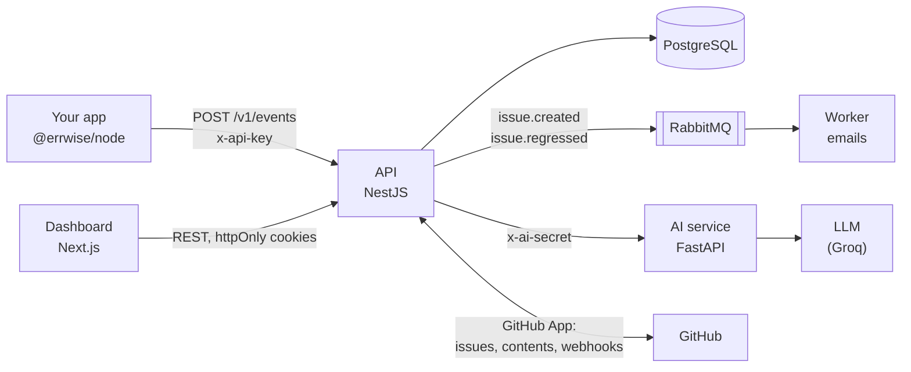

<div align="center">

# Errwise

**Error monitoring for developers. Install the SDK, see every crash in one dashboard, and understand it in one click.**

[](https://github.com/AzizHamdi99/errwise/actions/workflows/ci.yml)
[](https://www.npmjs.com/package/@errwise/node)


[SDK on npm](https://www.npmjs.com/package/@errwise/node) · [SDK guide](packages/sdk/README.md) · [Design decisions](docs/adr) · [Roadmap](docs/adr/Roadmap%20after%20the%20MVP.md)

</div>

---

## Why Errwise

When an app crashes in production, you usually find out from a user. Errwise collects every
error from your Node.js application, groups identical ones into **issues**, and shows them in
one dashboard with the stack trace, the environment, the release and the commit that ran.

Then it goes one step further than a list of errors:

- **It shows the code.** Each stack frame opens on the real lines of your repository, read from
  GitHub at the exact commit that was deployed.
- **It explains the error.** One click asks an LLM for a summary, the probable cause and a
  suggested fix, grounded in the stack trace and that code.
- **It fits your workflow.** Turn an issue into a GitHub issue, and GitHub stays in sync: close
  it there and Errwise resolves it, and if the error comes back, the GitHub issue is reopened.

It is a from-scratch, multi-tenant take on tools like Sentry, built to be readable, private by
default, and deployable on free tiers.

## Features

### Capture

- **Node SDK [`@errwise/node`](packages/sdk/README.md)** with zero runtime dependencies,
  Express and NestJS integrations, uncaught exception and unhandled rejection capture,
  batching, retries with backoff, and a safe flush before the process exits. It never throws
  into your app and never blocks it.
- **Deployed commit, automatically.** The SDK reads the commit from Vercel, GitHub Actions,
  Render, Railway, Heroku or Cloudflare Pages, or from `ERRWISE_COMMIT_SHA`.

### Group and triage

- **Idempotent ingestion** (`POST /v1/events`, single events or batches): a retried event is
  stored once, and the project always comes from the API key, never from the payload.
- **Fingerprinting** groups identical errors into one issue: the message is normalized (numbers,
  ids, quoted values) and combined with the top frame of your own code.
- **Issues dashboard** with filters, search, cursor pagination, stack traces that separate your
  code from `node_modules`, recent events, and statuses (`unresolved`, `resolved`, `ignored`).
- **Regression detection**: a resolved issue that happens again is reopened and flagged.

### Understand

- **Source context**: the lines around each failing frame, with the failing line highlighted and
  a link to the same line on GitHub. Opt-in per project, read on demand, never stored.
- **AI root-cause analysis**: a summary, the probable cause, a suggested fix and an honest
  confidence level, with the stack frames and source files it relied on. Cached per input, and
  capped per organization per day.

### Act

- **Email alerts** for new issues and regressions, to the members who follow the project.
  Delivered inline or through a RabbitMQ queue with retries and a dead-letter queue.
- **GitHub integration** (GitHub App): create a GitHub issue from an error in one click, close or
  reopen it on either side, and get a comment on the GitHub issue when the error comes back.

### Teams

- **Organizations** with three roles (`owner`, `admin`, `member`), invitations by email, and a
  `404` for anything outside your organization, so ids never leak.
- **Sign-in** with email and password or with Google.
- **API keys** per project: shown once, stored as a hash, revocable.

## Quick start (for your app)

```bash
npm install @errwise/node
```

```ts
import express from "express";
import { Errwise } from "@errwise/node";

Errwise.init({
  apiKey: process.env.ERRWISE_API_KEY, // ew_live_... from your project's API keys page
  environment: "production",
  release: "1.4.0",
});

const app = express();

app.get("/", () => {
  throw new Error("Something broke");
});

// After your routes, before your own error handler.
app.use(Errwise.expressErrorHandler());
app.listen(3000);
```

The error shows up in the dashboard a few seconds later, grouped with identical ones. NestJS,
manual capture, options and serverless use are covered in the [SDK guide](packages/sdk/README.md).

## Architecture



- **Only the API touches the database.** The AI service is stateless: the API sends it a scrubbed
  input and stores the answer.
- **Every API module is layered** as `controller -> service -> repository`. Controllers validate
  input with Zod and hold no rules, services hold the rules, and only repositories run queries.
- **One contract per boundary:** Zod schemas in `packages/shared` are used by the API, the
  dashboard and the SDK. The AI service mirrors its contract with Pydantic and rejects unknown
  fields.

### What happens to an error

1. The SDK captures it, adds the environment, release and commit, and sends it in a batch.
2. The API authenticates the key, validates the payload, and **scrubs** emails, tokens, keys and
   card numbers before anything is stored.
3. One transaction stores the event and creates or updates its issue. A duplicate event changes
   nothing, and a resolved issue that comes back is reopened.
4. After the commit, alerts go out: an email to the project's followers, and a reopened GitHub
   issue for a regression.
5. On the issue page, the dashboard reads the code around each frame from GitHub, and the AI
   analysis explains the error on request.

### Data model

```
User ──< Membership >── Organization ──< Project ──< ApiKey
                          │                ├──< Issue ──< Event
                          │                │      └──< IssueAnalysis
                          │                └──< ProjectSubscription >── User
                          ├──< Invitation
                          └──< AiUsage
```

- An `Issue` is unique per `(projectId, fingerprint)` and holds the counters.
- An `Event` is unique per `(projectId, eventId)`, which makes ingestion idempotent.
- Organizations and projects are soft-deleted.

## Tech stack

| Layer      | Choice                                                                 |
| ---------- | ---------------------------------------------------------------------- |
| Monorepo   | Yarn 4 workspaces, Turborepo                                           |
| API        | NestJS 11, TypeScript, Prisma 6, PostgreSQL 16                         |
| Dashboard  | Next.js, React 19, Tailwind CSS 4, shadcn/ui, TanStack Query           |
| SDK        | TypeScript, zero runtime dependencies, tsup, Vitest                    |
| AI service | Python 3.12, FastAPI, Pydantic, uv, Groq (OpenAI-compatible API)       |
| Messaging  | RabbitMQ (optional: alerts can also be sent inline)                    |
| Validation | Zod, shared by the API, the dashboard and the SDK                      |
| Auth       | JWT access tokens, rotating refresh tokens, bcrypt, Google OAuth       |
| Email      | Resend or SMTP, and a console driver for development                   |
| Hosting    | Vercel (dashboard, API, AI service), Neon (PostgreSQL)                 |

## Repository structure

```
errwise/
├─ apps/
│  ├─ api/        NestJS API: ingestion, issues, analysis, source context, GitHub,
│  │              notifications, auth, organizations, projects, API keys, and the worker
│  ├─ web/        Next.js dashboard
│  ├─ ai/         FastAPI AI service (Python, managed with uv, not a Yarn workspace)
│  └─ demo-app/   Small Express app that throws errors on demand
├─ packages/
│  ├─ shared/     Zod schemas and types shared by the API, the dashboard and the SDK
│  └─ sdk/        @errwise/node, published on npm
├─ docs/adr/      Design decisions, the GitHub integration guide, the roadmap
└─ docker-compose.yml   Local PostgreSQL and RabbitMQ
```

Apps never import other apps, only `packages/*`. The SDK has no runtime dependencies. Only the
API touches the database.

## Run it locally

### Prerequisites

- Node.js 24 and Corepack (`corepack enable`)
- Docker, for PostgreSQL and RabbitMQ
- Python 3.12 and [uv](https://docs.astral.sh/uv/), only for the AI service

### API and dashboard

```bash
# 1. Install dependencies
yarn install

# 2. Start PostgreSQL and RabbitMQ
yarn db:up

# 3. Configure the API, then edit the values (see below)
cp apps/api/.env.example apps/api/.env

# 4. Build the shared package and apply the migrations
yarn workspace @errwise/shared build
yarn db:migrate

# 5. Run the API (http://localhost:4000) and the dashboard (http://localhost:3000)
yarn dev:api
yarn dev:web
```

The dashboard needs `API_URL=http://localhost:4000` in `apps/web/.env.local`.

### Optional parts

```bash
# Email worker, when ALERT_DELIVERY=queue
yarn dev:worker

# AI service (http://localhost:8000), from apps/ai
cp .env.example .env      # AI_SERVICE_SECRET, LLM_API_KEY, LLM_MODEL
uv sync
uv run uvicorn app.main:app --reload --port 8000

# Demo app (http://localhost:5000) with a key from your local dashboard
ERRWISE_API_KEY=ew_live_... yarn dev:demo
```

Then open `http://localhost:5000/type-error` and the error appears in your dashboard.

### Configuration

Every variable is validated with Zod when the API starts, and it refuses to start if one is
missing or invalid. The full list is in [`apps/api/.env.example`](apps/api/.env.example).

| Group     | Variables                                                                                                   | Notes                                                                                     |
| --------- | ----------------------------------------------------------------------------------------------------------- | ----------------------------------------------------------------------------------------- |
| Core      | `DATABASE_URL`, `DIRECT_URL`, `JWT_SECRET`, `WEB_URL`, `API_PORT`                                           | Required, except `WEB_URL` and `API_PORT`, which have defaults                            |
| Email     | `MAIL_DRIVER` (`console`, `resend`, `smtp`), `MAIL_FROM`, `RESEND_API_KEY`, `SMTP_*`                        | `console` prints emails and their links in the API terminal                               |
| Alerts    | `ALERT_DELIVERY` (`queue` or `direct`), `RABBITMQ_URL`                                                      | `queue` needs RabbitMQ and the worker. `direct` sends inline, for serverless              |
| GitHub    | `GITHUB_APP_ID`, `GITHUB_APP_SLUG`, `GITHUB_APP_CLIENT_ID`, `GITHUB_APP_CLIENT_SECRET`, `GITHUB_APP_PRIVATE_KEY_BASE64`, `GITHUB_STATE_SECRET`, `GITHUB_WEBHOOK_SECRET` | Required. Placeholder values are enough if you do not use GitHub. See the [GitHub guide](docs/adr/Github%20integration.md) |
| Google    | `GOOGLE_CLIENT_ID`, `GOOGLE_CLIENT_SECRET`, `GOOGLE_CALLBACK_URL`                                           | Optional, for "Sign in with Google"                                                       |
| AI        | `AI_SERVICE_URL`, `AI_SERVICE_SECRET`, `AI_SERVICE_TIMEOUT_MS`, `AI_DAILY_LIMIT_PER_ORG`                    | Optional. The analysis is off until the URL and the secret are both set                   |
| Ingestion | `INGEST_RATE_LIMIT_PER_MINUTE`                                                                              | Per API key                                                                               |

### Useful scripts

| Command                                      | What it does                                         |
| -------------------------------------------- | ---------------------------------------------------- |
| `yarn dev:api` / `yarn dev:web`              | Run the API or the dashboard in watch mode           |
| `yarn dev:worker`                            | Run the email worker                                 |
| `yarn dev:demo`                              | Run the demo app                                     |
| `yarn db:up` / `yarn db:down`                | Start or stop PostgreSQL and RabbitMQ                |
| `yarn db:migrate`                            | Create and apply a migration (development only)      |
| `yarn db:studio`                             | Open Prisma Studio                                   |
| `yarn db:migrate:prod`                       | Apply migrations to production, before deploying     |
| `yarn build` / `yarn lint`                   | Build or lint every workspace                        |

## API overview

Every route is under `/v1`, except the GitHub webhook. Everything under
`/organizations/:orgId` requires login and membership of that organization.

| Area                | Routes                                                                                      | Who                     |
| ------------------- | ------------------------------------------------------------------------------------------- | ----------------------- |
| Ingestion           | `POST /events`                                                                              | API key (`x-api-key`)   |
| Auth                | `POST /auth/register`, `/login`, `/refresh`, `/logout`, `GET /auth/google`                  | Public / refresh cookie |
| Organizations       | `/organizations[/:orgId]`, `/members`, `/invitations`                                       | Members, by role        |
| Projects            | `/organizations/:orgId/projects[/:projectId]`, `/api-keys`, `/subscription`                 | Members; owner to edit  |
| Issues              | `GET .../issues`, `GET` and `PATCH .../issues/:issueId`                                     | Any member              |
| AI analysis         | `GET` and `POST .../issues/:issueId/analysis`                                               | Any member              |
| Source context      | `GET .../issues/:issueId/events/:eventId/source`                                            | Any member              |
| GitHub              | `.../projects/:projectId/github` (connect, repositories), `POST .../issues/:issueId/github` | Owner / any member      |
| GitHub webhook      | `POST /github/webhook`                                                                      | GitHub (HMAC signature) |

## Security and privacy

- **Scrubbing on the server.** Emails, bearer tokens, JWTs, provider keys, Luhn-checked card
  numbers, URL credentials and sensitive `context` keys are masked before an event is stored.
  The SDK is untrusted, so this never depends on the client.
- **Tenant isolation.** Every query is scoped by organization or project, and access to another
  tenant's data answers `404`, not `403`.
- **Secrets are hashed.** Passwords use bcrypt. API keys, refresh tokens and invitation tokens
  are stored only as SHA-256 hashes. A replayed refresh token revokes its whole session family.
- **AI with limits.** Only scrubbed text leaves for the LLM, never the event's free-form context.
  The error text is treated as untrusted data in the prompt, the answer must match a strict JSON
  schema, and the dashboard renders it as plain text. Analyses are cached and capped per
  organization per day.
- **Your code stays yours.** Source context is off until the project owner turns it on. Code is
  read from GitHub on demand and kept only in a short-lived memory cache. Frame paths from the
  SDK never build a request: only files that exist in the repository can be read.
- **Webhooks** are verified with an HMAC of the raw body. Ingestion is rate limited per API key.

Design decisions are recorded in [`docs/adr`](docs/adr):
[hashed API keys](docs/adr/001-hashed-api-keys.md),
[API versioning](docs/adr/002-api-versioning.md),
[ingestion and issues](docs/adr/003-ingestion-and-issues.md),
[AI analysis](docs/adr/004-ai-analysis.md),
[source context](docs/adr/005-source-context.md),
and the [GitHub integration guide](docs/adr/Github%20integration.md).

## Testing

Each part has its own unit tests, focused on the rules that matter: idempotency, scrubbing,
tenant isolation, concurrency, cost caps and untrusted input.

```bash
yarn workspace @errwise/api test      # API (Jest)
yarn workspace @errwise/node test     # SDK (Vitest)
cd apps/ai && uv run pytest           # AI service (pytest)
```

CI builds the shared package and the API on every pull request.

## Roadmap

**Done:** accounts and organizations, projects and API keys, the Node SDK on npm, ingestion and
fingerprinting, the issues dashboard, email alerts and regressions, the GitHub integration, AI
root-cause analysis, and source context.

**Next:**

1. An evaluation harness for the AI analysis, to measure every prompt change.
2. Suspect commits: the commits since the last good release that touched the failing files.
3. Similar issues, with embeddings in PostgreSQL.
4. Richer SDK data: breadcrumbs and user context.
5. Spike detection and alert throttling, and a retention job.

The full plan is in [Roadmap after the MVP](docs/adr/Roadmap%20after%20the%20MVP.md).

## Contributing

This is a personal project, but feedback is welcome. Open an issue to discuss a change before
sending a pull request. Commits follow [Conventional Commits](https://www.conventionalcommits.org/).

## License

The code in this repository is MIT licensed: see [`LICENSE`](LICENSE). The SDK,
[`@errwise/node`](packages/sdk), ships with its own copy of the same license. The license covers
the code, not the Errwise name and logo, and not the hosted service, which has its own terms.
